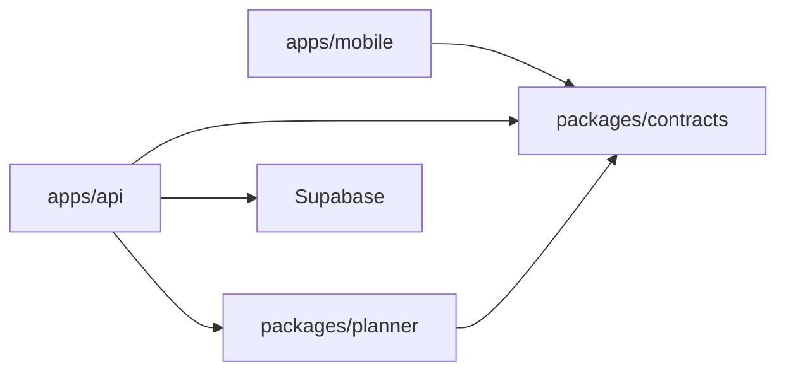

# Gather — Architecture Summary

Authoritative detail: [`SPEC.md`](../SPEC.md). This doc orients agents and developers.

## Product

Gather turns vague friend-group hangout intentions into confirmed plans (groups ~4–10), with inclusion-aware planning, voting, and calendar export.

## Stack (confirmed)

| Layer | Technology |
|-------|------------|
| Mobile | React Native + Expo |
| Auth | Supabase email OTP |
| Database | Supabase |
| Backend | Node.js + TypeScript |
| Planner | Importable TypeScript package (`packages/planner`) |
| Discovery | Bright Data + seeded fallback |
| Notifications | Expo push + in-app feed |
| Calendar | ICS export |

## Repository layout

```text
apps/mobile/          # Developer 1 — UI, navigation, client API usage
apps/api/             # Developer 2 — HTTP API, orchestration, scheduling
supabase/             # Developer 2 — migrations, local config
packages/contracts/   # Developer 2 maintains; all lanes consume DTOs + PlannerPort types
packages/planner/     # Developer 3 — agents, scoring, discovery, explanations
```

## Boundaries



- **Mobile** displays authoritative backend state; mocks allowed until Gate 3.
- **API** validates auth, loads authorized data, invokes planner, persists proposals/votes/events.
- **Planner** returns up to three ranked proposals; no direct DB or vote mutation.

## Integration gates

See [`docs/roadmap.md`](roadmap.md) for Gate 0–5 exit conditions from SPEC §8.

## Unresolved decisions

Do not implement guesses for items listed in SPEC §11. Track blockers in `state/CURRENT.md` and ADRs when partial choices are made.
