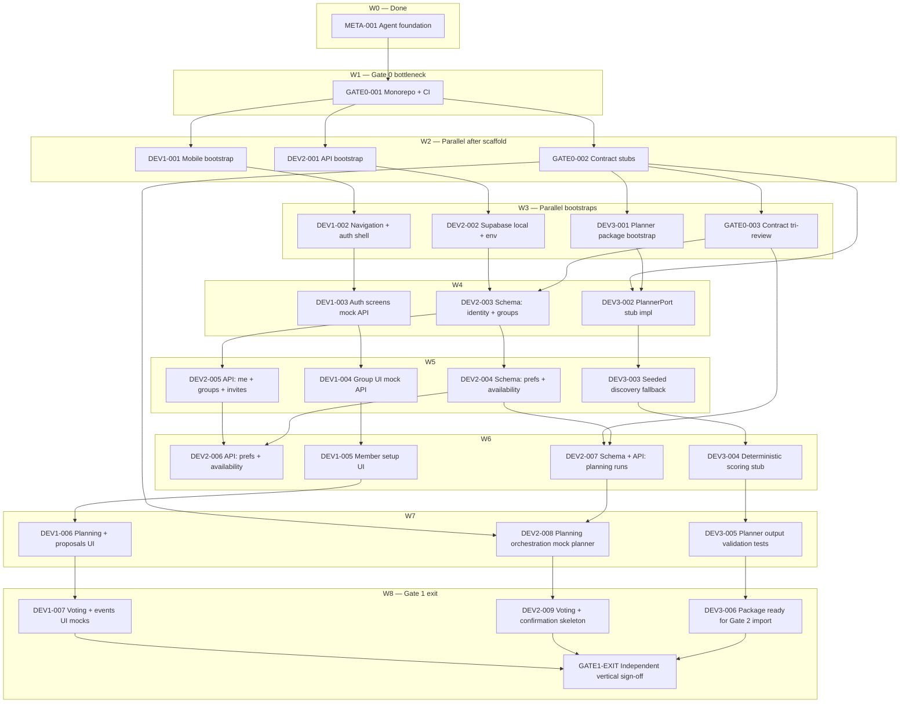

# Milestone DAG — Gate 0 → Gate 1 (approval draft)

**Author:** Orchestrator-style planning for **Developer 2** kickoff  
**Status:** **APPROVED** — orchestration active (ORCH-001)  
**Sources:** [`SPEC.md`](../SPEC.md) §4, §6, §8; [`docs/roadmap.md`](roadmap.md); [`docs/project-dag.md`](project-dag.md)

## Goal of this graph

Reach **Gate 1 exit** for all lanes:

- **Dev 2:** Auth + Supabase schema + API skeleton + manual planning with **mock `PlannerPort`**
- **Dev 1:** Screens + **API mocks** for onboarding → vote → confirmed event (parallel)
- **Dev 3:** Importable planner stub + seeded discovery path (parallel)

Gate 0 must complete first so all three `feature/*` branches share one base commit.

---

## Executive summary — parallel waves

| Wave | When | Parallel tracks |
|------|------|-----------------|
| W0 | Done | META-001 agent foundation |
| W1 | **Critical path** | **GATE0-001** (root workspace + CI) — *one integrator* |
| W2 | After W1 | **GATE0-002** ∥ **DEV1-001** ∥ **DEV2-001** (three directories, no overlap) |
| W3 | After W2 | **GATE0-003** review ∥ **DEV3-001** ∥ **DEV2-002** ∥ **DEV1-002** |
| W4 | After W3 | **DEV2-003** ∥ **DEV1-003** ∥ **DEV3-002** |
| W5 | After DEV2-003 + GATE0-003 | **DEV2-004** ∥ **DEV2-005** ∥ **DEV1-004** ∥ **DEV3-003** |
| W6 | After DEV2-005 + GATE0-002 frozen | **DEV2-006** ∥ **DEV2-007** ∥ **DEV1-005** ∥ **DEV3-004** |
| W7 | After DEV2-007 | **DEV2-008** ∥ **DEV1-006** ∥ **DEV3-005** |
| W8 | Gate 1 polish | **DEV2-009** ∥ **DEV1-007** ∥ **DEV3-006** → **GATE1-EXIT** review |

**Dev 2 starting point (you):** After **W1**, run **GATE0-002** and **DEV2-001** in parallel (contracts vs `apps/api` shell). Then follow the Dev 2 chain W3→W8.

---

## Full dependency graph (Mermaid)



---

## Dev 2 critical path (your spine)

```text
GATE0-001 → GATE0-002 ─┬→ GATE0-003 (you lead contracts; others review)
         └→ DEV2-001 → DEV2-002 → DEV2-003 → DEV2-004 ─┬→ DEV2-006
                                                      └→ DEV2-005
DEV2-005 + DEV2-006 → (merge on branch) → DEV2-007 → DEV2-008 → DEV2-009 → GATE1-EXIT
```

**Longest pole for Dev 2:** `DEV2-003` → `DEV2-007` → `DEV2-008` (planning + mock planner).

---

## Task definitions (proposed IDs)

Statuses are **proposed** until this DAG is approved and task files are created.

### Gate 0

| ID | Lane | Depends | Parallel with | Outcome |
|----|------|---------|---------------|---------|
| **GATE0-001** | integration | META-001 | — | pnpm/npm workspace, TS base, CI stub, `.env.example`, feature branch instructions |
| **GATE0-002** | core-api | GATE0-001 | DEV1-001, DEV2-001 | `PlannerPort`, core DTOs, `CONTRACTS_VERSION`, no SPEC §11 guesses |
| **GATE0-003** | core-api + all | GATE0-002 | DEV3-001, DEV2-002, DEV1-002 | Dev 1/3 **approve** contract PR; record freeze in ADR-002 or task handoff |

### Developer 2 — Gate 1

| ID | Depends | Parallel with | Allowed surface | Outcome |
|----|---------|---------------|-----------------|---------|
| **DEV2-001** | GATE0-001 | GATE0-002, DEV1-001 | `apps/api/**` | Fastify/Express TS app, health route, test harness |
| **DEV2-002** | DEV2-001 | DEV1-002, DEV3-001 | `supabase/**`, `apps/api` config | Local Supabase, JWT validation middleware stub |
| **DEV2-003** | DEV2-002, GATE0-003 | DEV1-003, DEV3-002 | `supabase/migrations/**` | Profiles, groups, memberships, invitations |
| **DEV2-004** | DEV2-003 | DEV2-005†, DEV1-004, DEV3-003 | `supabase/migrations/**` | Preferences, availability (private columns documented) |
| **DEV2-005** | DEV2-003 | DEV2-004†, DEV1-004, DEV3-003 | `apps/api/**`, contracts | `GET/POST` groups, invites, join, members, `/v1/me` |
| **DEV2-006** | DEV2-004, DEV2-005 | DEV2-007‡, DEV1-005, DEV3-004 | `apps/api/**` | `GET/PUT` preferences + availability + privacy tests |
| **DEV2-007** | DEV2-004, GATE0-003 | DEV2-006‡, DEV1-005, DEV3-004 | `supabase/**`, `apps/api/**` | Planning run + proposal tables; GET/POST planning routes (stub state machine) |
| **DEV2-008** | DEV2-007, GATE0-002 | DEV1-006, DEV3-005 | `apps/api/**` | Mock `PlannerPort`, persist ≤3 proposals, failure recovery |
| **DEV2-009** | DEV2-008 | DEV1-007, DEV3-006 | `apps/api/**`, migrations | Vote PUT skeleton, confirmed event read, idempotency tests (rules TBD → stub enums) |

† **DEV2-004** and **DEV2-005** both need **DEV2-003** but touch different paths (`migrations` vs `routes`) — **same developer should land migrations before routes**, or split: one migration task then two API tasks in parallel.

‡ **DEV2-006** and **DEV2-007** can run in parallel after **DEV2-004** + **DEV2-005** if migrations for planning are in **DEV2-007** only.

### Developer 1 — Gate 1 (parallel mock UI)

| ID | Depends | Parallel with |
|----|---------|---------------|
| DEV1-001 | GATE0-001 | GATE0-002, DEV2-001 |
| DEV1-002 | DEV1-001 | DEV2-002, DEV3-001 |
| DEV1-003 | DEV1-002 | DEV2-003, DEV3-002 |
| DEV1-004 | DEV1-003 | DEV2-005, DEV3-003 |
| DEV1-005 | DEV1-004 | DEV2-006, DEV3-004 |
| DEV1-006 | DEV1-005 | DEV2-008, DEV3-005 |
| DEV1-007 | DEV1-006 | DEV2-009, DEV3-006 |

### Developer 3 — Gate 1 (parallel planner)

| ID | Depends | Parallel with |
|----|---------|---------------|
| DEV3-001 | GATE0-001, GATE0-002 | DEV2-002, DEV1-002 |
| DEV3-002 | DEV3-001, GATE0-002 | DEV2-003, DEV1-003 |
| DEV3-003 | DEV3-002 | DEV2-005, DEV1-004 |
| DEV3-004 | DEV3-003 | DEV2-006, DEV1-005 |
| DEV3-005 | DEV3-004 | DEV2-008, DEV1-006 |
| DEV3-006 | DEV3-005 | DEV2-009, DEV1-007 |

### Gate 1 exit

| ID | Depends | Outcome |
|----|---------|---------|
| **GATE1-EXIT** | DEV2-009, DEV1-007, DEV3-006 | Checklist vs SPEC §8 Gate 1; open Gate 2 tasks |

---

## Parallelization rules used

1. **No overlap** on `packages/contracts` after GATE0-002 except Dev 2 + review (GATE0-003).
2. **GATE0-001** is the only hard global serializer.
3. **Supabase migrations** on `feature/core-api`: serialize **DEV2-003 → DEV2-004** before dependent API tasks; do not parallelize conflicting migration files.
4. **DEV2-005** and **DEV2-006** can parallelize with Dev 1/3 once schema slices exist.
5. **DEV2-008** waits on **contract freeze (GATE0-003)** and **DEV2-007** but not on Dev 3’s real AI — mock only for Gate 1.

---

## Explicitly deferred (SPEC §11 — not in this DAG)

- Weekly scheduler technology and timezone policy
- Majority/veto/revote final rules (stubs only in DEV2-009)
- Creao/Bright Data live integration (Gate 2+)
- Inclusion debt formulas
- ICS serialization owner detail (stub route OK in Gate 1)

---

## Approval checklist

Reply **approve** (or edits) on:

- [ ] Task IDs and wave breakdown
- [ ] Dev 2 spine order (GATE0-002 + DEV2-001 parallel OK?)
- [ ] GATE0-003 as human contract sign-off before planning schema (DEV2-007)
- [ ] Splitting DEV2-004/005 parallel vs sequential migrations
- [ ] Who owns **GATE0-001** (integration owner = Dev 2 for hackathon?)

**After approval:** create `tasks/<ID>.md` for each row, update `tasks/index.md`, set `state/CURRENT.md` milestone to Gate 1 execution, optionally add context packs for W2 tasks.
